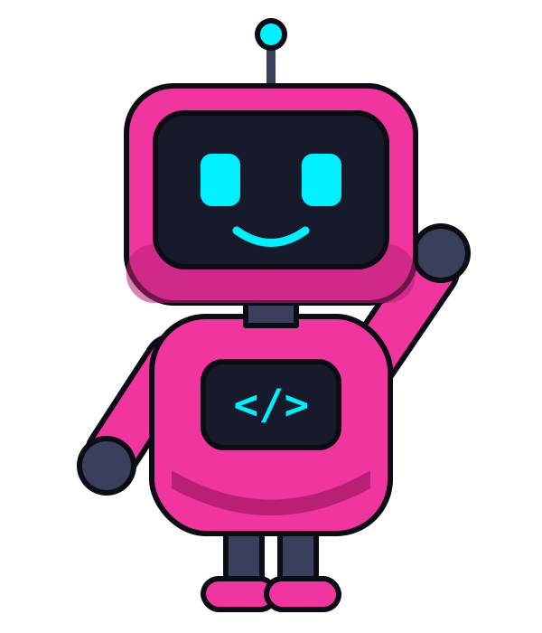

# Brand

## Bit, the Vibe with Amit robot

An original mascot designed for this channel (Oct 2026): neon pink body, cyan screen face, `</>` on the chest.

- `bit/bit.svg`: editable vector source
- `bit/bit.png`: 600×700 render with a transparent background, for profile pictures and thumbnails
- `bit/design-options.png`: the three original concepts (Bit was chosen)

**Palette:** pink `#F0359E` / shade `#B81F75` · neon pink captions `#FF2BD6` · cyan `#00F0FF` · screen `#171A2B` · background `#0D0D14`

## Video template

`video-template/build_eval_video.py` builds a 1080×1920 vertical video with Bit presenting:

- the mouth moves with the loudness of the voiceover; blinks; expressions for normal, shocked and happy
- section labels (`// 01 — the question`) top-left, live counter top-right
- animated PASS/FAIL rows, callout card, result screen and CTA
- tick, buzz and chime sound effects mixed under the voice

Section timings are matched to the pauses in the voiceover.
