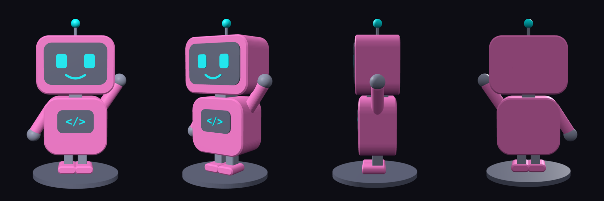

# Bit desk figure (3D print)

175 mm tall on a 96 mm base. Modelled in code from `../bit.svg` (`bit3d.py`, using manifold3d).

| File | Use |
| --- | --- |
| `bit_multicolour.3mf` | Multi-colour printers (e.g. Bambu AMS) or print services: one object per colour |
| `bit_pink.stl` | Head, body, arms, feet (#F0359E) |
| `bit_dark.stl` | Screens and base (#1E2132) |
| `bit_cyan.stl` | Eyes, smile, `</>`, antenna ball (#00F0FF) |
| `bit_grey.stl` | Neck, legs, hands, antenna stem (#464C69) |
| `bit_single_colour.stl` | Everything as one piece, to print in one colour and paint |

All parts are positioned in place, so they line up when loaded together. Print with supports (under the arms and head).
